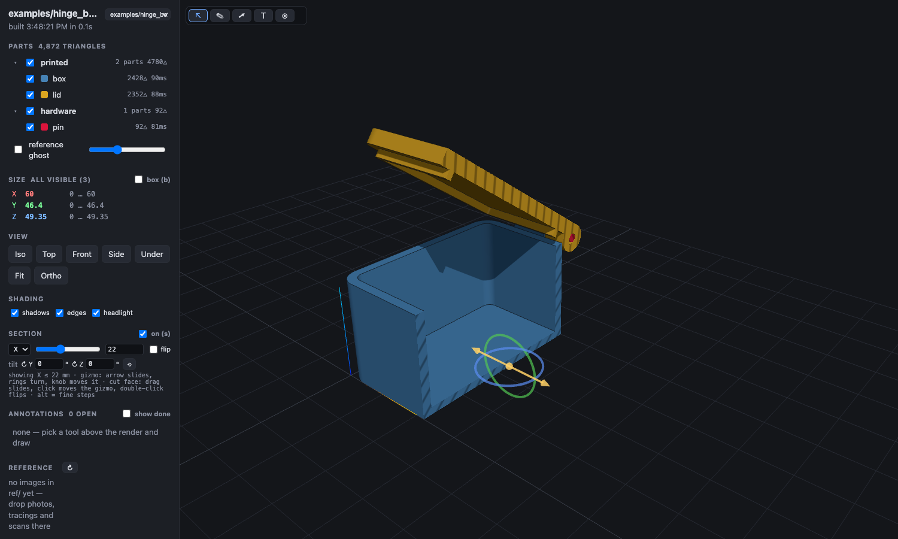

# armenscad

A workbench for designing 3D-printable parts in [OpenSCAD](https://openscad.org) together with an AI coding agent. It was built around [Claude Code](https://claude.com/claude-code), and the viewer and tools are also useful on their own.



OpenSCAD models are code, which an agent writes well, but neither of you can see what the other means. This repo is the shared surface:

- **`viewer/`**: a browser viewer that rebuilds every part on save. Per-part colours and groups, a parameter panel read from the `.scad` file, section cuts with hatched caps (overlapping parts show in red), bounding-box sizes, reference photos, and notes you draw on the render that the agent can read back with the parts and millimetre coordinates under each stroke.
- **`tools/`**: command-line checks the agent runs instead of eyeballing: collision tables across poses, STL facts (volume, watertightness, shell count), parameter write-back, volume comparison against a reference mesh, STL cross-sections, 3MF, Shapr3D and LDraw readers.
- **`lib/armenscad/`**: shared OpenSCAD modules (printable fillets, sweeps, teardrop holes, settled clearances), used as `use <armenscad/shape.scad>` from any folder.
- **`template/`**: the skeleton of a model folder: model, viewer manifest, print layout, collision pairs, tolerance coupon, export scripts, README.
- **`skills/openscad/`**: the playbook that tells Claude how to use all of the above. The repo is a Claude Code plugin (`armenscad`), so installing it gives Claude the skill and the `armenscad` command everywhere.
- **`bin/armenscad`**: one command for all of it: `browse`, `init`, `check`, `notes`, `install`, and every script in `tools/` by name.

## Requirements

- macOS or Linux. Windows is untested (the tools are bash and Python; WSL should work).
- **OpenSCAD, a development snapshot.** The 2021.01 stable release has no Manifold backend and will not work. macOS: `brew install --cask openscad@snapshot`. Linux: a nightly AppImage or package from [openscad.org/downloads](https://openscad.org/downloads.html#snapshots). It must be on `PATH` as `openscad`, or set `OPENSCAD=/path/to/openscad`.
- [Bun](https://bun.sh) for the viewer.
- Python 3 and [uv](https://docs.astral.sh/uv/) for the tools. `stlinfo.py`, `voxcmp.py` and `shapr_dump.py` are `uv run --script` files that fetch their own dependencies (numpy, msgpack); the collision check and the export scripts call `stlinfo.py`.
- Claude Code, if you want the agent side.

## Install

As a Claude Code plugin (recommended; also puts `armenscad` on Claude's PATH):

```
/plugin install armenscad --marketplace redswoop/armenscad
```

then once, in a shell, so your own shell and the OpenSCAD GUI find it too:

```sh
armenscad install     # ~/.local/bin/armenscad, lib symlink in OpenSCAD's library folder, bun install for the viewer
```

Or without Claude: `git clone https://github.com/redswoop/armenscad.git && armenscad/bin/armenscad install`.

## Quick start

```sh
cd "$(armenscad root)"
armenscad browse .
```

The browser opens on the list of models in that folder; pick `examples/hinge_box`. Then:

- Edit `examples/hinge_box/hinge_box.scad` and save: the page rebuilds.
- Change `lid_deg` in the parameter panel and press Apply.
- Press `s` for a section cut and drag the hatched face.
- Run the collision table: `armenscad check examples/hinge_box/check.scad 'lid_deg=0' 'lid_deg=90' 'lid_deg=180'`

The viewer listens on localhost only. `HOST=0.0.0.0 armenscad browse .` opens it to your network; the API has no authentication, so do that only on a network you trust.

## Your own model

```sh
mkdir ~/3D && cd ~/3D                     # any folder: a workspace is just a folder with models in it
armenscad init bracket "wall bracket for the router"
armenscad browse .
```

`init` copies `template/` to `bracket/` and makes it its own git repo; `browse` serves every model under the folder you give it (three levels deep), so http://127.0.0.1:5180/bracket/ is live. Something with several assemblies is one repo with a subfolder each: `armenscad init boat/hull`, `armenscad init boat/hatch`. Models say `use <armenscad/shape.scad>` to reach the shared library from anywhere.

## With Claude Code

With the plugin installed, start `claude` in your workspace or model folder and ask for a part; the `openscad` skill loads with the plugin, and each model's `CLAUDE.md` (project memory) loads when Claude touches its files. The skill has Claude keep every dimension a named parameter, look at its own work in the viewer, run the collision pairs at the design extremes, print a tolerance coupon before the real parts, and leave each model's `README.md` as a handoff for the next session. A browser tool (Claude in Chrome or similar) lets it take screenshots of the viewer and drive it through `window.viewer`.

Draw on the render (pen `p`, arrow `a`, label `t`, points `k`), type a caption, and tell Claude to look at the notes: `armenscad notes <model folder>` gives it each note with the camera pose and the geometry under it.

## Layout

| Path | What |
|---|---|
| `.claude-plugin/` | Plugin and marketplace manifests. |
| `bin/armenscad` | The command. |
| `skills/openscad/` | The Claude skill. `docs/lessons.md` is its appendix of things learned. |
| `viewer/` | Bun API server (`server.js`, port 3003) and Vite + three.js front end (port 5180). `armenscad browse [DIR]` starts it on a workspace folder (next free ports if busy). |
| `tools/` | `check.sh`, `stlinfo.py`, `scadset`, `notes`, `voxcmp.py`, `slice.sh`, `svgpts.py`, `stlshift.py`, `3mfinfo.py`, `3mf2stl.py`, `shapr_dump.py`, `ldraw2stl.py` (LDraw part to a reference STL), `stlshells.py` (union a mesh-soup download's closed shells, report the open ones), `new-model.sh`. Usage is in each file's header comment. |
| `lib/armenscad/` | Shared modules, see `lib/README.md`. Run `tools/install-lib.sh` once so OpenSCAD finds them from anywhere (the viewer and tools find them on their own). |
| `template/` | New-model skeleton. |
| `examples/` | Demo models tracked in this repo. |
| `.claude/skills/openscad/SKILL.md` | The workflow, written for the agent; a good read for humans too. |
| `docs/NOTES.md` | Design diary: how this grew and what is still on the list. |

The clearances in `lib/armenscad/fit.scad` were settled on one printer (Bambu H2C, 0.4 nozzle, PLA). Treat them as starting points and print the coupon.

## Licence

GPL-3.0-or-later, see `LICENSE`. Copyright 2026 Armen Nakashian.
